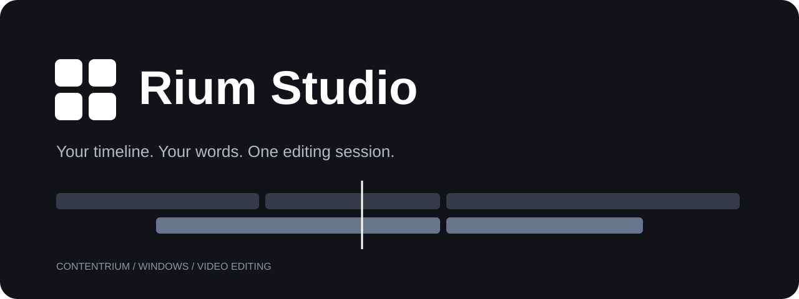
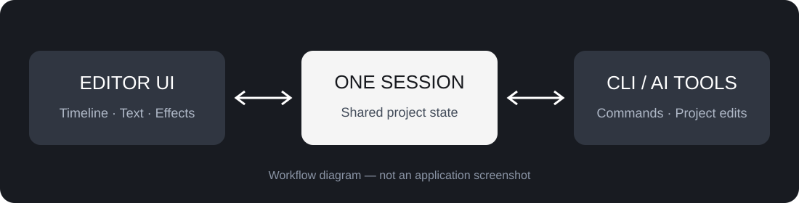

<p align="center"></p>
<h1 align="center">Rium Studio</h1>
<p align="center"><strong>타임라인 편집과 명령 기반 작업을 하나의 편집 세션에서.</strong><br>영상을 자르고, 자막과 효과를 더하고, CLI를 통해 편집 작업을 연결하는 영상 편집기입니다.</p>
<p align="center"><a href="https://github.com/contentriumkorea/rium-studio/releases/tag/v0.17.0-rium.1"></a>  <a href="LICENSE-MIT"></a></p>
<p align="center"><a href="#빠르게-시작하기">설치하기</a> · <a href="https://github.com/contentriumkorea/rium-studio/releases/tag/v0.17.0-rium.1">다운로드</a> · <a href="#사용-모습">사용 모습</a> · <a href="INSTALL.md">상세 안내</a></p>

---

## 빠르게 시작하기

Windows x64용 미리보기 배포입니다.

[](https://github.com/contentriumkorea/rium-studio/releases/download/v0.17.0-rium.1/Rium-Studio-Windows-x64.zip)

1. ZIP 파일을 다운로드해 쓰기 가능한 폴더에 압축을 풉니다.
2. **설치:** `Install Rium Studio.cmd`를 실행합니다.
3. **포터블:** 설치 없이 `Rium Studio.cmd`를 실행합니다.

[상세 설치 및 업데이트 안내 →](INSTALL.md)

## 편집을 이어가는 세 가지 방식

| 01 · 타임라인 | 02 · 텍스트와 효과 | 03 · 연결된 작업 |
| :--- | :--- | :--- |
| **영상과 오디오 편집** | **내용과 표현 수정** | **UI와 CLI를 같은 세션으로** |
| 클립을 배치하고 길이와 위치를 조정합니다. | 편집 가능한 텍스트와 글꼴, 효과 값을 다룹니다. | 명령 기반 편집을 열린 편집기에 연결합니다. |

## 사용 모습

<p align="center"></p>

**화면에서 편집하거나 명령으로 수정해도 같은 로컬 세션을 사용합니다.**

위 이미지는 동작 구조를 설명하는 도식입니다. 실제 프로그램 화면 캡처가 아닙니다.

<details><summary><strong>추가 사용 예시</strong></summary>

- GUI에서 영상 클립과 텍스트를 배치합니다.
- AI 도구가 CLI를 호출해 프로젝트를 수정하도록 연결할 수 있습니다.
- 결과를 `.rium` 프로젝트로 저장해 계속 편집합니다.

</details>

## 설치·배포 안내

| 방식 | 사용 방법 |
| :--- | :--- |
| 사용자 계정에 설치 | ZIP 압축 해제 후 설치 스크립트 실행. 바탕화면·시작 메뉴 바로가기를 만듭니다. |
| 포터블 실행 | 같은 ZIP에서 실행 스크립트를 엽니다. 설정은 패키지 옆 `data` 폴더에 저장합니다. |
| CLI | 패키지 폴더의 터미널에서 `rium.cmd`를 실행합니다. |

## 이렇게 사용하세요

```text
rium.cmd --help
rium.cmd
```

AI 계정이나 API 이용권은 포함하지 않습니다. 사용하는 AI 도구에서 CLI 호출을 구성해야 합니다.

## 적용 범위와 제한

- 이번 배포는 Windows x64 미리보기 버전입니다. macOS·Linux 실행 파일은 포함하지 않습니다.
- GUI와 CLI의 공유 세션은 같은 PC의 같은 사용자 계정 범위입니다. 여러 PC의 공동 편집 서비스는 아닙니다.
- 중요한 프로젝트는 별도 사본으로 작업하세요. 모든 편집 기능·코덱·GPU 환경의 검수를 완료한 정식 안정판은 아닙니다.
- 실행 파일은 코드 서명되지 않았습니다. 보안 기능 해제를 요구하지 않습니다.
- 시스템이나 글꼴 관리 프로그램에서 활성화한 글꼴은 사용자 환경을 참조합니다. 개인 글꼴 파일은 배포하지 않습니다.

<details><summary><strong>상세 안내와 검증 범위</strong></summary>

배포 빌드·패키지 파일 목록·SHA-256 및 다운로드 연결을 확인합니다. 이번 릴리스의 기능·UI 사용 검증은 생략했습니다. 설치 방법은 [INSTALL.md](INSTALL.md), 변경 사항은 [릴리스](https://github.com/contentriumkorea/rium-studio/releases/tag/v0.17.0-rium.1)를 참고하세요.

</details>
<details><summary><strong>English overview</strong></summary>

Rium Studio is a Windows video editor with timeline editing, editable text and effects, and a local session shared by its UI and CLI. This preview includes a ZIP package with optional per-user installation. It is unsigned and has not completed functional acceptance testing.

</details>

---
<p align="center"><strong>CONTENTRIUM</strong><br><a href="LICENSE-MIT">MIT</a> · <a href="LICENSE-APACHE">Apache-2.0</a> · <a href="NOTICE">저작권 및 제3자 고지</a> · <a href="https://github.com/contentriumkorea/rium-studio/releases/tag/v0.17.0-rium.1">Latest release</a></p>
<p align="center"><a href="https://contentrium.com/"></a></p>
